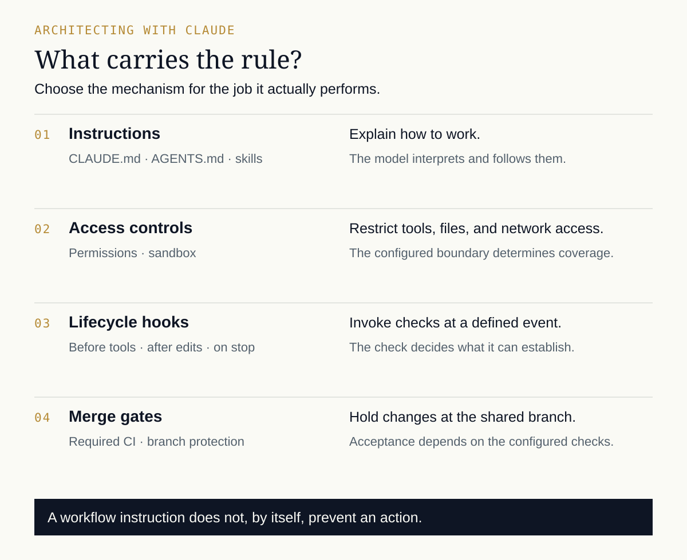

A coding agent can produce an implementation faster than I can read it carefully. If I respond by spending the rest of the day reviewing every line, I have accelerated one part of development and moved the queue to another. As the volume grows, the temptation is to skim more, trust the test count, and accept the summary. None of that tells me whether we built the right thing.

The problem starts earlier than the review. An agent can implement a poor design quite faithfully. It can write tests that preserve the same misunderstanding, then produce a convincing explanation of why they pass. By the time I see the diff, decisions about responsibility, ownership, dependencies, and failure behavior are embedded throughout it. Pulling those decisions back out is expensive work.

Anthropic has described this pressure in its own engineering organization. Its [Code Review announcement](https://claude.com/resources/articles/code-review) discusses the growing gap between code production and review capacity. Its [account of the development lifecycle](https://claude.com/resources/articles/how-anthropic-secures-its-ai-native-software-development-lifecycle) describes combining automated checks and agentic review with human decisions at selected points.

The harness around that work includes the context, tools, instructions, checks, and permissions within which an agent works. Claude Code provides the mechanisms. We still have to decide how to use them to develop software we understand and can maintain.

[Anthropic's best practices](https://code.claude.com/docs/en/best-practices) are a useful foundation: plan the work, give the agent ways to verify it, preserve project knowledge, bound its actions, separate responsibilities, and automate the recurring steps. I use those practices across my own projects. The architectural work is in connecting them, so a decision made during planning survives implementation and can be examined when the result comes back.

<!--more-->

## The roles in the workflow

I separate the work into five roles. These names describe their responsibilities in my workflow:

| Role | Responsibility |
| --- | --- |
| Planner | Research and iterate on the system design with me, producing plans for the backlog. |
| Architect | Turn an agreed plan into public headers and explicit invariants, then coordinate its execution. |
| Researcher | Answer bounded questions from sources and return cited evidence. |
| Implementer | Build against the approved contracts and run the required checks. |
| Reviewer | Independently examine the result and report differences from the contracts and evidence. |

The planner works with me in the planning conversation. My `/architect` workflow moves an agreed plan into a separate execution thread, where the architect coordinates the work. The researcher, implementer, and reviewer are [custom Claude Code subagents](https://code.claude.com/docs/en/sub-agents), each with its own brief, context, model assignment, and tool access. The workflow determines when they are called and what gets passed between them.

## Planning is where we work through the design

Plan mode gives me a place to work with the planner before committing to an implementation. We research the problem, visualize approaches, and revise the design together. I don't expect to ask for a plan once and receive something ready to build.

We start with what the system needs to do and the constraints it has to work within. Before assigning a file, we need to understand what the component owns and why that responsibility belongs there. If we are introducing a cache, the design needs to account for who owns the data, what invalidates it, and what happens when the operation behind it fails. Those questions lead into the surrounding system, where the consequences of the choice will show up.

Research is part of that work. The planner can investigate the existing implementation, ask the researcher to examine a reference, or bring back a paper or vendor document relevant to a design question. I want the evidence and its implications presented together: what the source establishes, which conditions matter, and what adopting that approach would mean for our system. A missing answer may require more investigation before we can sensibly choose a direction.

I also ask for diagrams and visualizations while we are developing the design. A data-flow diagram makes it easier to follow ownership and movement. A sequence diagram exposes ordering and failure paths. A dependency diagram can show that an apparently local change puts two components in a relationship we did not intend. When the choice involves cost or capacity, a table or plot can make the assumptions easier to examine than another page of prose.

Those representations give us something shared to reason over. I can point to a transition and ask what happens if the operation fails there, or question why data crosses the same boundary twice. The planner can revise the design and show how the change affects the rest of the flow. A diagram that looks coherent may fall apart under those questions, which is useful to discover before the implementation makes it harder to change.

This is cooperative work. I bring the purpose of the project, the constraints, and my judgment about what matters. The planner brings research, proposals, and consequences for us to examine. I push back, ask it to compare alternatives, and change my own position when the evidence calls for it. The conversation needs to leave us with reasons for the decisions, not just agreement on an attractive drawing.

That reasoning has to run across earlier decisions too. A new requirement may expose a mistake in a previous design. Preserving every earlier choice can make the next component more complicated while leaving the original problem untouched. I want the planner to identify those conflicts and work through them with me before more code depends on them.

The output is a design another thread can work from: responsibilities, relationships, constraints, selected approaches, relevant evidence, and any questions still open. It also identifies the boundaries between pieces of work and the dependencies that determine their order.

## Hand the plan to an execution workflow

My `/architect` command is a custom harness workflow. It kicks off a separate chat thread and moves the planned work there. The planning conversation can continue while that thread takes the agreed plan through architecture, implementation, and review.

The architect's first job in that thread is to turn the plan into public headers and place the invariants in each header: the conditions callers can rely on and the implementation must preserve. That is a separate step from developing the design. A plan may assign ownership to a subsystem, but the interface has to express how ownership passes into and out of it. A design may require a failure to leave existing state unchanged; the header needs to state that promise where the implementer and reviewer will see it.

The architect can call on the researcher to resolve details needed for those contracts. It also proposes the checks, identifies omissions, and defines the implementer's ownership. I review the headers, invariants, test list, and omissions before implementation begins. A service could use an API contract and failure semantics for the same purpose. A frontend could specify user-visible states, the transitions between them, and what happens when an operation fails: whether input is preserved, what the user sees, and how they can recover. Each gives us an agreement to review before delegating its implementation.

For domain guidance, I give the architect access to my C++ and performance guideline servers through MCP. It retrieves the rules relevant to the design and records which ones informed its choices, so we can discuss a specific rule without loading the whole reference corpus.

After approval, that thread coordinates implementation, verification, and independent review. It carries the plan and contracts through the handoffs while I continue the planning conversation.

[](images/planning-and-execution.svg)

This separation is what makes a planning backlog useful. I can keep working through the next design while a ready plan is being implemented. Where plans are independent, separate execution threads and worktrees can progress in parallel. Where one depends on another's contract, that dependency determines when it is ready to move. The backlog records the design work needed to make those decisions, rather than just collecting prompts to send to idle agents.

An execution thread can still uncover something that changes the design. It brings that question back instead of quietly rewriting the agreement. We then have to consider which other plans depend on the decision. Keeping planning separate gives those questions somewhere to be resolved with the wider system in view.

On a team, those decisions need named owners. The engineer responsible for a piece of work owns its plan, contract decisions, and acceptance of the result. A change that affects another component's contract is worked through with that component's owner before dependent work proceeds. The agreed contracts and verification evidence live in shared project records, where the people and agents doing the next work can find them. This distributes the responsibility across the team instead of routing every decision through one architect.

## Give the agent a way to establish what worked

The contracts give us something to verify. We now need checks that can reject an implementation when it violates those promises, including one that looks plausible and compiles cleanly. Asking Claude to double-check its answer does not give it a new observation to work from.

Anthropic's work on [long-running agent harnesses](https://www.anthropic.com/research/effective-harnesses-for-long-running-agents) describes agents declaring work complete before adequately exercising it. Providing a way to run and inspect the system gives the agent a feedback loop it can use: make the change, observe a failure, correct it, and run the check again.

The checks need to match the purpose of the work. In Serenity, my GPU rendering project, an optimization needs a measured frame time. A change intended to preserve the picture needs an output comparison; a change intended to alter it needs a before-and-after image I can judge. The build is necessary, but it cannot answer the question that prompted the change.

Those observations need to survive the handoff. My implementer reports commands actually run, their exit codes, and the evidence produced. Unverified behavior, omissions, and work outside its assigned ownership are reported separately. A platform we haven't exercised stays unverified even when all the checks on another platform pass. I can then decide what remains to be done without first undoing an optimistic completion summary.

### What earns a test

The test suite is part of the architecture: it guards the behavior we need to preserve while changing the implementation. An agent can generate a large suite very quickly, so its contents need as much judgment as the code it checks.

I test contracts someone depends on: a returned result, a refused input, ownership and lifetime, a failure that must leave state intact, or an invariant required by another component. In numerical work, that includes agreement with a reference under defined inputs and tolerances. In performance-sensitive code, it may include a promise such as no allocation in the frame loop. Those tests protect a reason the system can be used the way it is designed.

Before a scenario is written, I want two answers: which contract does it guard, and what change would this scenario catch that nothing else already catches? If the compiler or an existing scenario catches the same mistake, another test needs a different justification. A regression test should fail against the broken behavior so we know it distinguishes the condition we care about.

Unit tests exercise those contracts with small, controlled inputs. Integration tests establish that the real boundaries work together. They need to identify both what they demonstrate and which failures would still pass. A downstream change in generated text, for example, does not establish that a particular internal model edit was applied correctly. The check has to observe the value or behavior its claim is about.

### What I leave out

I don't want tests for private helpers simply because they exist, assertions about an internal container, or mock expectations that prescribe every call in an algorithm. When a layout, ordering, or allocation constraint really is part of the contract, we state it there and test it for that reason.

I also leave out tests that merely restate what a thin wrapper forwards to the standard library or operating system, duplicate scenarios, and assertions about demo settings that are expected to change. These add obligations to the codebase without protecting another meaningful property of it.

The shape of the suite matters too. One table-driven scenario can cover the relevant cases of an invariant without creating a new test executable for each function. Expensive fixture data can be prepared once and shared. A few integration checks can establish that the paths are connected without repeating every unit-level assertion through a real model, a GPU, or the browser.

This is a recurring deficiency in my agent workflows. Two slices in the game project arrived with nearly as many test lines as implementation lines. Tests were organized around functions, repeated expensive setup, and checked details no caller read. Review kept adding more. The response was to review the test list before implementation, require a reason for each scenario, and measure test volume and runtime before accepting the work. A reviewer is allowed to recommend removing a test. More testing is not automatically better engineering.

### How chasing 100% coverage breaks the regression harness

Coverage tells us which code was exercised. It does not tell us whether the assertions would detect the behavior breaking. When 100% becomes the acceptance condition, the remaining uncovered lines become work to manufacture tests around, regardless of whether those tests protect a useful contract.

That pressure rewards the implementation-coupled tests I leave out. A behavior-preserving refactor then fails the suite because the internals changed. The agent responds by rewriting the tests alongside the implementation until everything is green again.

We are now changing both the implementation and the assertions that were supposed to tell us whether we broke it. The new tests may agree perfectly with the new code while a behavior the old system provided has disappeared. The suite has lost its value as an independent regression harness for that change, however green the coverage report looks.

My rule is that a behavior-preserving refactor should leave the contract tests intact. If the contract changes, we review that decision and change its tests deliberately. If only the internal arrangement changes, a test that demands rewriting needs to be narrowed to the actual contract or removed. I want the suite to let me replace the implementation while continuing to tell me whether the system still does what its callers depend on.

## Keep AGENTS.md small

The testing corrections need to survive the conversation, but that does not mean copying the project's documentation into the agent instructions. The README should already explain what the project is, how it is organized, and how to build and test it. `AGENTS.md` should direct the agent to that material when its work requires it.

Claude Code loads project instructions through [`CLAUDE.md`](https://code.claude.com/docs/en/memory). Mine points to `AGENTS.md`. I want that shared file to stay small: agent-specific constraints, pointers to the existing documentation, and corrections for mistakes that keep recurring. Repeating the README makes every agent carry information it may not need and gives us two places to maintain the same instructions.

The reading requirement should follow the assignment. An implementer needs the repository's build and test instructions. A researcher answering a bounded question about a paper may only need its brief and the source. It should not have to read the application's setup instructions before investigating an algorithm. Detailed procedures belong with the relevant workflow or role, where they are loaded for that work.

### Recurring mistakes earn their place

This is the part of `AGENTS.md` I consider most valuable. The README can explain the intended way to work, but experience tells us where agents repeatedly go wrong. A short correction makes that lesson available to the next session before it repeats the mistake.

Testing supplies several of mine: expanding the suite beyond the agreed test list, moving code merely to make a test compile, and claiming that an integration test proves more than it observes. The entry needs to identify the mistake and direct a different decision. It does not need to reproduce the entire testing policy.

```text
Recurring mistake: tests coupled to implementation.
A behavior-preserving refactor must leave contract tests intact.
Do not expose private structure or move code just to make a test pass.
```

The same applies to treating an earlier design decision as unchangeable or inheriting another project's choices as requirements. These are specific corrections learned from the work, rather than general reminders to write good software.

Keeping the file small requires editing it as we learn. Consolidate overlapping corrections, remove obsolete ones, and keep longer procedures in the role or workflow that uses them. A mechanically enforced rule can point to its check. The agent should get the correction and know where to look next without receiving the whole repository in its startup instructions.

## Put boundaries around the work

Writing a boundary into `AGENTS.md` tells the agent how it should work. We also need to decide which boundaries the environment must enforce. An ownership list can explain where an implementer's work belongs and when to bring a decision back; permissions can restrict the files, commands, credentials, and external systems available to it.

Claude Code's [sandbox](https://code.claude.com/docs/en/sandboxing) limits filesystem and network access for the commands it covers. [Hooks](https://code.claude.com/docs/en/hooks) attach checks to lifecycle events. A pre-tool hook can reject an operation; an after-edit hook can run a formatter; a stop hook can check whether required evidence exists before the agent finishes. Required CI checks and branch protection provide a gate where changes join the shared codebase.

[](images/instructions-and-enforcement.svg)

This is also how we make room for useful autonomy. Asking someone to approve the same routine build command all day consumes attention without improving the design. Establish the environment and the allowed operations so that routine work can proceed. Keep human attention available for changed contracts, unexpected results, and decisions with consequences beyond the assigned work.

The mechanism has to cover the action we care about. Removing an editing tool does not make an unrestricted shell read-only. A stop hook should distinguish a finished implementation from an agent waiting for a design decision. These are ordinary engineering questions about the boundary, the paths through it, and the conditions under which it should permit work.

In my current workflows, several requirements still live in agent briefs rather than enforced hooks. Those remain dependent on the agent following its instructions. Moving one into a hook removes that reliance at the covered event, but the check still has to establish the property we intended.

## Separate responsibilities, then choose the models

The role boundaries also let us choose how much model capacity to assign to each job. We can use that separation to control cost while keeping the reasoning capacity needed for each responsibility.

I put a frontier reasoning model, currently Fable, on planning and architecting because those decisions propagate through the implementation. Research and implementation have more bounded outputs, so I assign Sonnet to source investigations and Opus to building against the approved contracts. The role definitions let me make those choices without asking each model to carry the whole process.

Fable also handles review, in a separate context from the implementation.

I don't need the planning model spending its context and inference budget on every source lookup or implementation step. I want that capacity applied where a decision can change the shape of the work. Sonnet can return cited evidence for a bounded question without also being asked to choose the architecture; Opus can implement a contract without repeating the design investigation.

The handoffs make this practical. A vague task passed to another model just makes that model repeat the investigation. A usable plan, explicit contracts, and a bounded research question let it start at the right point. The cost to watch is the cost of getting to an accepted result, including repeated context, corrections, and my own time working through avoidable ambiguity.

[](images/design-to-evidence.svg)

The reviewer has a separate responsibility from the implementer even when both can write good code. I want it approaching the change from the contract and evidence, without the history of defending the implementation. It reports discrepancies, including missing failure paths, unsupported claims, and departures from the agreed design. I reserve the decision about whether a departure is justified.

A role becomes concrete in its subagent definition. Here is a condensed reviewer example, stored as `.claude/agents/contract-reviewer.md`:

```markdown
---
name: contract-reviewer
description: Review assigned code against its approved contracts. Return findings.
tools: Read, Grep, Glob
model: fable
---

The brief supplies the changed files, approved contracts, and relevant rules.
If an input is missing, report it before proceeding.

Read those files. Check promised behavior, failure paths, and whether tests
observe the contracts they claim to protect.

Return each finding as:
file:line | contract or rule | observed difference

Do not edit files or approve the work.
If there are no findings, list what you inspected and limit the claim to it.
```

The tool list gives this example reading and search access without an editing tool or shell. The body defines what the review needs and what comes back. It does not carry the project's build instructions or the planning conversation; the brief supplies the material relevant to this review. That keeps the role focused and its output usable by the coordinating workflow.

That is where machine review helps carry the volume. The reviewer can examine each change against a defined agreement, while I examine findings and the decisions that require judgment. Deterministic checks handle the properties they can establish reliably, leaving the model review to examine relationships those checks do not cover.

I also bound the review loop. My workflow uses one review pass and a correction pass, with checks run again and unresolved findings reported. Repeatedly asking another agent to find something else can expand the work indefinitely. The process needs a defined route back to a decision about what the result requires.

## Make the process repeatable

The review limit is one of the decisions I encode in the `/architect` skill. [Skills and custom commands](https://code.claude.com/docs/en/skills) give the procedure a durable home: the inputs each role receives, the checks it runs, the result it returns, and the conditions that stop the work or bring a decision back to me.

The same approach works for routine delivery. A single custom command can review a change, run its checks, commit the intended files, push the branch, and open a pull request with the verification evidence. Its instructions should define which findings stop it and when it has authority to proceed. That saves me from conducting the same sequence by hand each time.

Where a step must run regardless of the model's choice, the workflow uses the hooks and gates described earlier. The skill should point to the same check command used elsewhere in the project, so its definition of success does not drift from the one enforced at merge.

The workflow also needs to return a result the planning thread can use. Completed work, unresolved findings, and changes to assumptions can affect what is ready in the backlog. Parallel execution only helps if those results make it back into the next planning decision.

## What changes about the engineering work

I don't read every implementation line in my projects. I review the design and contracts, inspect the evidence, and follow findings into the code when I need to understand what happened. A disagreement about a failure path may send me into a few functions. A performance result may send me back to the data flow or the assumptions we made about memory. That work requires understanding the system, even when Claude wrote the implementation.

For a team starting to work this way, I would use the next meaningful change to establish the loop. Work through the design together, make its contracts explicit, and decide what evidence would establish that they hold. Give the implementer that agreement and have a separate reviewer examine the result against it. When something goes wrong, look at where the process lost the intent: an unresolved design choice, a poor handoff, a check that observed the wrong thing, or a recurring mistake that never reached the next agent. Improve that part before extending the workflow to more parallel work.

That brings us back to the review bottleneck. Reading faster cannot make up for a process that leaves its architectural decisions implicit until the diff arrives. Planning, contracts, checks, and independent review give us earlier places to examine those decisions and a clearer basis for accepting the result. Claude can then carry more of the implementation without requiring us to surrender our understanding of what we are building.
