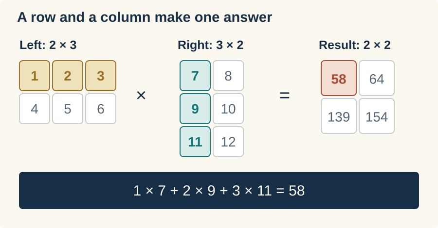
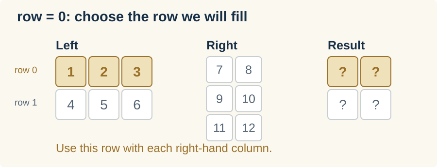
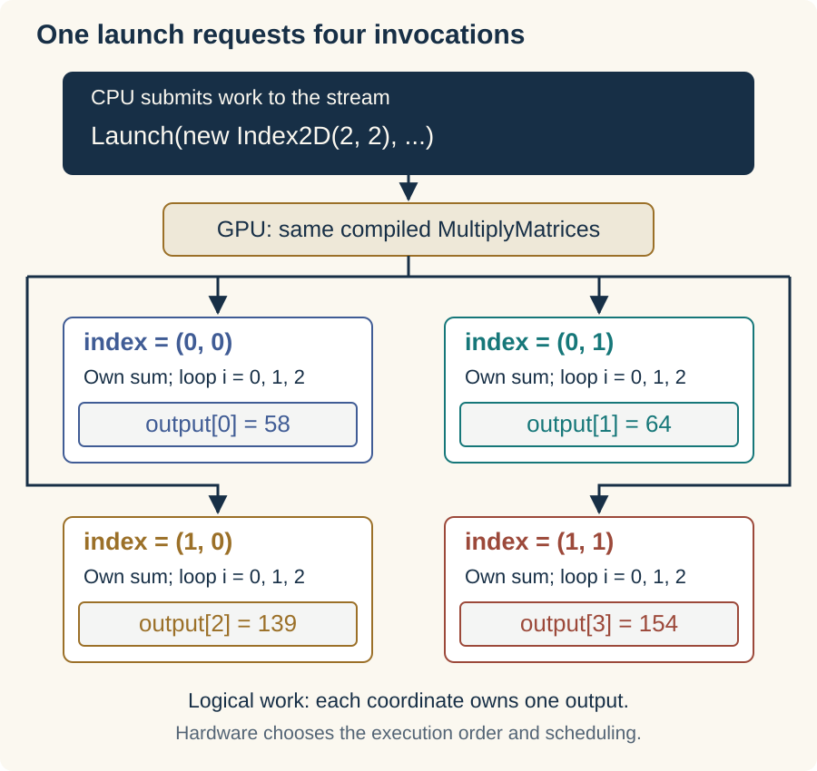
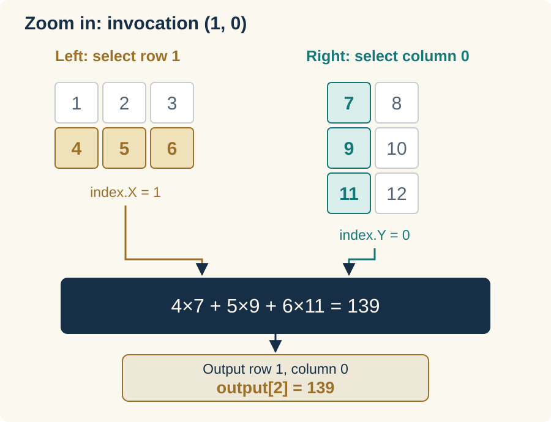

{
  "title": "Matrix multiplication",
  "description": "Build a GPU kernel that computes one matrix-product element per invocation, then use it to apply weights to a vector.",
  "lesson": 3,
  "date": "2026-10-27",
  "draft": false,
  "start_tag": "lesson-02",
  "end_tag": "lesson-03",
  "tags": [
    "C#",
    "GPU",
    "Transformers"
  ],
  "math": false,
  "type": "application",
  "series": [
    "Let's Build a Transformer!"
  ],
  "part": 3,
  "canonicalURL": "https://cradle.plainsight-systems.com/lessons/03-matrix-multiplication/",
  "cradle_source": {
    "repository": "https://github.com/plainsight-systems/cradle",
    "revision": "600500852d8c2ce741d2c3d78f0b95cef1731bdd",
    "article": "articles/03-matrix-multiplication/index.md"
  }
}

[Starting code](https://github.com/plainsight-systems/cradle/tree/lesson-02) · [Completed code](https://github.com/plainsight-systems/cradle/tree/lesson-03)

In [Buffers and shapes](https://andrewphunter.com/writing/cradle-02-buffers-and-shapes/), we gave our data rows and columns and got the GPU adding matrices. Now let’s put those rows and columns to work. We’ll build matrix multiplication, the operation we’ll use throughout the transformer to apply weights to an input.

We’ll start with a small product we can check by hand, then write the CPU version. Its loops will help us work out how to divide the calculation across the GPU. By the end, we’ll have one kernel handling both matrices and vectors, and we’ll be able to follow exactly how it gets each answer.

## Pick up the cradle

First, get the cradle running where we left it. Start from `lesson-02`, with a clean working tree:

```sh
git switch -c work/lesson-03 lesson-02
dotnet run --project src/Cradle
```

You should see `11, 22, 33, 44, 55, 66` and `All 6 matrix elements match.` Good, we have our starting point. Keep the dependency pin and backend setting from the previous lessons. If you use an override such as `-p:ILGPUBackend=OpenCL`, keep putting it on commands that build.

## A quick reminder

Let’s use a product small enough to check without reaching for a calculator:



Take the highlighted row from the left and column from the right, multiply corresponding values, then add those products. For the top-left answer, that gives us `1×7 + 2×9 + 3×11 = 58`.

That sum of products is a *dot product*. Notice how the three values in our left row pair with the three values in our right column. If the column had only two values, we’d run out of partners before reaching the end of the row. That is why `left.Columns` must equal `right.Rows`: those dimensions tell us how many values we’re pairing in each dot product.

Now keep that first row and move to the next right-hand column. We get `1×8 + 2×10 + 3×12 = 64`, which goes beside 58. We’ve used the first left row with both right columns, so we’ve filled the first row of our result. Repeat with the second left row and we get 139 and 154 underneath.

Each left row therefore gives us a result row, and each right column gives us a result column. Our two left rows paired with two right columns produce four answers arranged as `2×2`. The matching threes in `2×3` multiplied by `3×2` tell us how long each dot product is; the two twos tell us where all those answers go.

## Give us an answer to check

Let’s put that calculation into our `Matrix` class. This CPU version will give us answers to compare with the GPU, and its loops will make the division of work easier to see.

Before calculating anything, we’ll check that each row and column have the same number of values to pair. In `Matrix.cs`, add a constant alongside the existing error messages:

```csharp
private const string MultiplicationDimensionsMustMatch =
    "Matrix multiplication requires the left column count to equal the right row count.";
```

Then add the multiplication operator after `operator +`. Once the dimensions match, we can allocate one output position for every left-row/right-column pair and fill them in:

```csharp
public static Matrix operator *(Matrix left, Matrix right)
{
    ArgumentNullException.ThrowIfNull(left);
    ArgumentNullException.ThrowIfNull(right);
    if (left.Columns != right.Rows)
        throw new ArgumentException(MultiplicationDimensionsMustMatch, nameof(right));

    var result = Create(left.Rows, right.Columns);

    // loop through each row of left
    for(int row = 0; row < left.Rows; row++)
    {
        // loop through each column of right
        for(int column = 0; column < right.Columns; column++)
        {
            float sum = 0;

            //perform the dot product
            for (int i = 0; i < left.Columns; i++)
            {
                sum += left[row, i] * right[i, column];
            }

            result[row, column] = sum;
        }
    }

    return result;
}
```

Let’s follow those loops through the first answer. The outer loop chooses a left row:

```csharp
for(int row = 0; row < left.Rows; row++)
```

At `row = 0`, we’ll use 1, 2, and 3 to fill the first row of the result. The question marks below mean answers we haven’t calculated yet.



Inside that, the second loop chooses a right column:

```csharp
for(int column = 0; column < right.Columns; column++)
```

At `column = 0`, we’ve selected 7, 9, and 11. Together, the row and column identify one answer, `result[0, 0]`. We start its `sum` at zero.

![With row 0 held fixed, the second loop selects right column 0, containing 7,9,11. The target is now just result[0,0], and its running sum starts at zero.](images/cpu-loop-column.svg)

The innermost loop walks through the pairs while `row` and `column` stay put:

```csharp
for (int i = 0; i < left.Columns; i++)
{
    sum += left[row, i] * right[i, column];
}
```

Watch `i` move across the left row and down the right column. At each step, `*` makes a product and `+=` adds it to our running sum. The underlined cells are the pair we’re reading on that step:

![Three steps of the inner loop with row and column fixed at zero. At i=0, multiply 1 by 7 and sum becomes 7. At i=1, multiply 2 by 9 and sum becomes 25. At i=2, multiply 3 by 11 and sum becomes 58. Store 58 in result[0,0] after the loop.](images/cpu-loop-dot-product.svg)

Now we can store 58 in `result[0, 0]`. The column loop moves to column 1, resets `sum`, and uses the same left row to calculate 64. Only after both columns are done does the outer loop move to row 1, where we’ll calculate 139 and 154.

The result gets its own storage, after the shape check. Leave the addition operator and its tests in place too. It still has a job waiting for it when we build the transformer’s residual connections.

We’re about to ask this operator to check the GPU’s answers, so let’s check its own arithmetic first. Add this test inside `MatrixTests`:

```csharp
[Fact]
public void MultiplicationProducesKnownRectangularProduct()
{
    var left = Matrix.FromArray(2, 3,
    [
        1, 2, 3,
        4, 5, 6
    ]);

    var right = Matrix.FromArray(3, 2,
    [
        7, 8,
        9, 10,
        11, 12
    ]);

    var result = left * right;

    Assert.Equal(2, result.Rows);
    Assert.Equal(2, result.Columns);
    Assert.Equal(
        new float[] { 58, 64, 139, 154 },
        result.ToArray());
}
```

Run the tests:

```sh
dotnet test Cradle.slnx -c Release --no-restore
```

You should now have 13 passing cases, including the 12 from lesson 2. Those four expected values came from our arithmetic above, so they give us something independent to judge the code by.

Now give it something it should refuse. Two individually valid matrices can still be the wrong shapes to multiply:

```csharp
[Fact]
public void MultiplicationRejectsIncompatibleDimensions()
{
    var left = Matrix.Create(2, 3);
    var right = Matrix.Create(2, 3);

    Assert.Throws<ArgumentException>(() => left * right);
}
```

A left row has three values here, but a right column has only two. Run the tests again; you should have 14 passing cases. We can calculate an answer and reject inputs that don’t belong together. Now let’s get that calculation onto the GPU.

## One launch, four invocations

Look back at the CPU version. The two outer loops choose an output position, and the inner loop calculates the dot product for that position. The code finishes 58 before starting on 64. Notice, though, that nothing in the calculation for 64 uses that first answer.

It only needs values from the two input matrices. The same is true of 139 and 154. All four answers can be calculated independently, which gives us a way to do the work in parallel: give the GPU a separate job for each output position.

We used that arrangement for addition in the last lesson. Each job read two values and added them. This time, each job has a whole row and column to work through. We’ll write one kernel, `MultiplyMatrices`, that calculates one dot product. The GPU will run that same kernel for each output position; each run is an *invocation*, with its own row, column, and running sum.

We tell ILGPU how many positions to cover with `Launch`. Our result has two rows and two columns, so we request `new Index2D(2, 2)`. That gives us the four coordinates `(0, 0)`, `(0, 1)`, `(1, 0)`, and `(1, 1)`. Here is the launch we’ll put into our program shortly, using the dimensions of our CPU result, `expected`:

```csharp
stream.Launch(
    new Index2D(expected.Rows, expected.Columns),
    index => MultiplyMatrices(
        index, left.Columns, right.Columns,
        leftBuffer.View, rightBuffer.View, outputBuffer.View)
);
```

The CPU makes this call once. ILGPU’s generated launch code supplies a different `index` to each GPU invocation, along with the dimensions and buffer views we pass in. Follow the arrows from that one call to the four answers:



That is how we replace the two outer loops: each invocation receives the row and column it would otherwise have reached by looping. We keep the inner loop because that invocation still has three pairs to multiply and add into its own `sum`.

Those jobs can run alongside one another. We don’t choose their order or require all four to run at once; the GPU schedules the work. They can safely share the input buffers because they only read from them, and each writes to a different output position.

Let’s write the kernel for one of those jobs. `index.X` will be its row and `index.Y` its column. We’ll call the matching row/column length `sharedDimensions`, which is 3 in our example. Replace `AddMatrices` in `Program.cs` with:

```csharp
private static void MultiplyMatrices(
    Index2D index,
    int sharedDimensions,
    int rightColumns,
    ArrayView<float> left,
    ArrayView<float> right,
    ArrayView<float> output)
{
    float sum = 0;

    for (int i = 0; i < sharedDimensions; i++)
    {
        var leftElement = left[index.X * sharedDimensions + i];
        var rightElement = right[i * rightColumns + index.Y];
        sum += leftElement * rightElement;
    }

    output[index.X * rightColumns + index.Y] = sum;
}
```

Keep `CheckResults` and `WriteSection`; we can use them as they stand. Before wiring the new kernel into `Main`, let’s follow one of those invocations through the code.

## Follow one invocation

Pick `(1, 0)`, the lower-left box. Its `index.X` selects left row 1, and its `index.Y` selects right column 0. We pass 3 for `sharedDimensions` and 2 for `rightColumns`:



Remember [how we laid out rows in a flat array in lesson 2](https://andrewphunter.com/writing/cradle-02-buffers-and-shapes/#six-values-two-rows): `row * columns + column` skips whole rows, then moves to a position within the selected row. That gives us an array offset, not the value stored there. The GPU buffers use that same layout. We’re applying the rule to each buffer below, using its own row width:

```text
Left array index:   index.X * sharedDimensions + i
Right array index:  i * rightColumns + index.Y
Output array index: index.X * rightColumns + index.Y
```

Now let `i` run from 0 to 2 and watch the sum grow. Brackets in the read boxes contain array indices; the larger numbers underneath are the values found there.

![Three iterations inside invocation (1,0): read values 4 and 7 to make sum 28; read 5 and 9 to make sum 73; read 6 and 11 to make sum 139. Write 139 once to output[2].](images/invocation-loop.svg)

At the end, this invocation writes 139 and its job is done. Each of the others has its own sum and output position, so they don’t need to wait for one another. Try following `(1, 1)` yourself: the left values stay 4, 5, 6, while the right values become 8, 10, 12. You should arrive at 154.

## Launch over the output shape

We’ll want to run more than one example, so put the allocation, launch, readback, and checking in a helper. Add this above `Main` in `Program`:

```csharp
private static bool RunMultiplication(
    AcceleratorStream stream, Matrix left, Matrix right)
{
    var expected = left * right;

    // Allocate and upload the inputs; the kernel fills the output buffer.
    using var leftBuffer = stream.Allocate1D((float[])left);
    using var rightBuffer = stream.Allocate1D((float[])right);
    using var outputBuffer = stream.Allocate1D<float>(expected.Length);

    // Launch one kernel invocation per output element.
    stream.Launch(
        new Index2D(expected.Rows, expected.Columns),
        index => MultiplyMatrices(
            index, left.Columns, right.Columns,
            leftBuffer.View, rightBuffer.View, outputBuffer.View)
    );

    stream.Synchronize();

    var actual = Matrix.FromArray(
        expected.Rows, expected.Columns, outputBuffer.GetAsArray1D());

    if (!CheckResults(actual, expected))
    {
        return false;
    }

    Console.WriteLine($"Shape: {actual.Rows}x{actual.Columns}");
    Console.WriteLine($"Actual:   {string.Join(", ", actual)}");
    Console.WriteLine($"Expected: {string.Join(", ", expected)}");
    Console.WriteLine();
    Console.WriteLine($"All {actual.Length} matrix elements match.");

    return true;
}
```

You’ve seen most of this in lesson 2. We borrow the stream and own the buffers through `using` declarations. The managed matrices stay on the CPU; the kernel gets their dimensions and buffer views.

Watch the **output shape** here. Each input has six values, but we only want four answers. That is why both allocation and launch use the dimensions of `expected`. The CPU multiplication has already checked compatibility before we allocate anything. `left.Columns` supplies the loop length; `right.Columns` supplies the right/output row width.

After the launch, `Synchronize` makes the CPU wait until the GPU work is finished. Then we can bring the answers back and check them. Our existing finite-value check and tolerance cover these small integer-valued examples.

Let’s run it. Replace `Main` with this version for the rectangular product:

```csharp
private static void Main()
{
    try
    {
        using var gpu = GpuRuntime.Create();
        var accelerator = gpu.Accelerator;

        WriteSection("Selected GPU");
        Console.WriteLine($"GPU: {accelerator.Name} ({GpuRuntime.CompiledBackend})");

        var left = Matrix.FromArray(2, 3,
        [
            1, 2, 3,
            4, 5, 6
        ]);

        var right = Matrix.FromArray(3, 2,
        [
            7, 8,
            9, 10,
            11, 12
        ]);

        var stream = accelerator.DefaultStream;

        WriteSection("Matrix multiplication");
        if (!RunMultiplication(stream, left, right))
        {
            Environment.ExitCode = 1;
            return;
        }


    }
    catch (InvalidOperationException e)
    {
        Console.Error.WriteLine(e.Message);
        Environment.ExitCode = 1;
    }
}
```

Keep the existing ILGPU imports. We’re reusing `GpuRuntime`, `CheckResults`, and `WriteSection` from lesson 2; our new kernel and helper do the multiplication work.

Build the tests, then run the executable:

```sh
dotnet test Cradle.slnx -c Release --no-restore
dotnet run --project src/Cradle -c Release --no-build --no-restore
```

The 14 tests should still pass. Then, after the selected GPU, look for:

```text
--- Matrix multiplication ---

Shape: 2x2
Actual:   58, 64, 139, 154
Expected: 58, 64, 139, 154

All 4 matrix elements match.
```

If your backend needs an override, keep it on the test command that builds the application. The following `--no-build` run uses that binary. The known generated-code warnings on Metal are the ones discussed in lesson 1.

There it is: our matrix product running on the GPU! The 139 we followed through the diagrams is sitting in the third array slot, index 2. We checked the CPU calculation against our hand-worked answers, and now all four GPU answers agree with it.

## Apply weights to a vector

We can already use this to apply weights to a vector. Give the right-hand matrix just one column:

```text
Weights: 2×3     Input: 3×1     Output: 2×1

1  2  3              1              14
4  5  6     ×        2       =      32
                     3
```

The answers are `1×1 + 2×2 + 3×3 = 14` and `4×1 + 5×2 + 6×3 = 32`. Each weight row makes one output from the same three input values. Our weights are six numbers we picked ourselves for now; later, the model will supply them.

Our kernel already has everything it needs for that shape. Set the right matrix’s width to 1, and the output width becomes 1 too. Let’s give it a test in `MatrixTests`:

```csharp
[Fact]
public void MultiplicationAppliesMatrixToColumnVector()
{
    var weights = Matrix.FromArray(2, 3,
    [
        1, 2, 3,
        4, 5, 6
    ]);

    var vector = Matrix.FromArray(3, 1,
    [
        1,
        2,
        3
    ]);

    var result = weights * vector;

    Assert.Equal(2, result.Rows);
    Assert.Equal(1, result.Columns);
    Assert.Equal(new float[] { 14, 32 }, result.ToArray());
}
```

Run the tests again; you should have 15 passing cases. To give the GPU the same inputs, add this inside `Main`’s `try` block, after the first `RunMultiplication` check:

```csharp
var vector = Matrix.FromArray(3, 1,
[
    1,
    2,
    3
]);

WriteSection("Matrix-vector multiplication");
if (!RunMultiplication(stream, left, vector))
{
    Environment.ExitCode = 1;
    return;
}
```

Run the application again:

```sh
dotnet run --project src/Cradle -c Release --no-restore
```

The rectangular product should still pass. After it, you should see:

```text
--- Matrix-vector multiplication ---

Shape: 2x1
Actual:   14, 32
Expected: 14, 32

All 2 matrix elements match.
```

Two answers from three inputs, using the kernel we just wrote. This launch requests `(0, 0)` and `(1, 0)`, and each runs the same three-iteration loop. With `rightColumns` set to 1, the right-hand reads visit array indices 0, 1, and 2. We changed the shape and the data; the kernel took care of the rest.

## Keep this kernel

The cradle can now apply a matrix of weights to an input vector, with an answer we know how to check. We can point to the invocation that produced each output and follow every value it read. That gives us a useful piece of the transformer to build on.

Keep this kernel around. We’ll use it as the transformer grows, then return to it in the performance installment. There is work waiting for us there: neighboring invocations read some of the same inputs, and we can look at sharing and reusing those reads once we have a working engine to measure.

We’ll also have native library implementations to compare with. ILGPU’s [cuBLAS wrapper](https://github.com/m4rs-mt/ILGPU/blob/24cb87d6669c177428bd4ef1b8d05d9652b21c4b/Src/ILGPU/Runtime/Cuda/Libraries/CuBlas.cs) exposes NVIDIA’s GEMM (matrix-matrix) and GEMV (matrix-vector) operations, but requires CUDA. Our pin has no Metal equivalent or common native-BLAS API across backends. That’s a gap when we want Windows, Linux, and Mac readers to follow along. Our own kernel gives us an implementation we can understand and use across those backends.

If you want to compare your version, the [completed lesson-03 snapshot](https://github.com/plainsight-systems/cradle/tree/lesson-03) has the code and tests. You can also run the same repository check we’ve used throughout:

```sh
python3 scripts/check_dotnet.py
```

That checks the backend builds and CPU-side tests, then restores the platform default. Follow it with an application run using your chosen backend to exercise your GPU.

When we reach the model’s final weight matrix, its outputs will be scores for possible next tokens. We’ll need probabilities to choose among them. Next time we’ll write softmax, give it numbers that make the first version fall over, and work out how to put it right.
