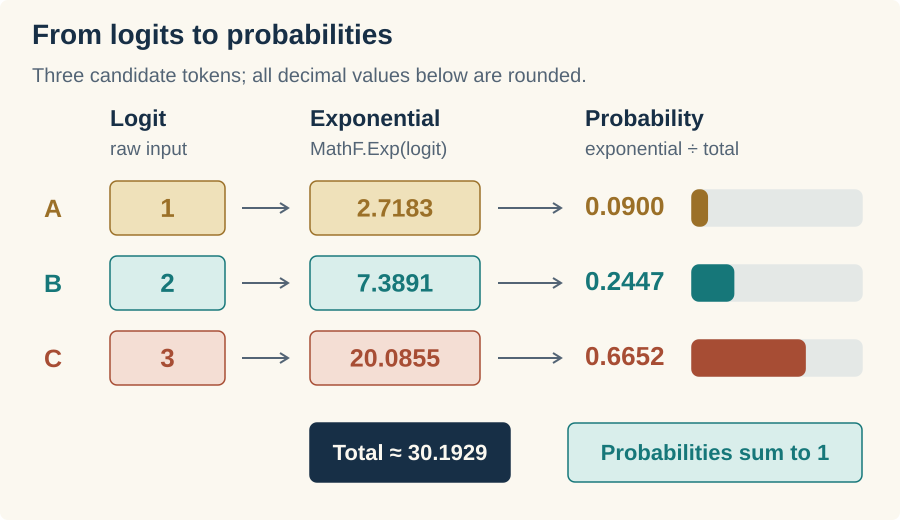

{
  "title": "Softmax",
  "description": "Turn raw model scores into a probability distribution, build softmax on the GPU, and fix the overflow that breaks its first implementation.",
  "lesson": 4,
  "date": "2026-11-04",
  "draft": false,
  "start_tag": "lesson-03",
  "end_tag": "lesson-04",
  "tags": [
    "C#",
    "GPU",
    "Transformers"
  ],
  "math": false,
  "type": "application",
  "series": [
    "Let's Build a Transformer!"
  ],
  "part": 4,
  "canonicalURL": "https://cradle.plainsight-systems.com/lessons/04-softmax/",
  "cradle_source": {
    "repository": "https://github.com/plainsight-systems/cradle",
    "revision": "17e51fe10b0196a7aca8c0e920552fd867cbc62a",
    "article": "articles/04-softmax/index.md"
  }
}

[Starting code](https://github.com/plainsight-systems/cradle/tree/lesson-03) · [Completed code](https://github.com/plainsight-systems/cradle/tree/lesson-04)

In [Matrix multiplication](https://andrewphunter.com/writing/cradle-03-matrix-multiplication/), we built a kernel that applies weights to an input. Eventually, the model’s final weight matrix will produce a score for every possible next token. Those raw scores are called *logits*. A larger logit means the model favors that token over one with a smaller logit.

That gives us an ordering, but it doesn’t give us probabilities. A logit of 3 isn’t 3%, and it doesn’t make a token three times as likely as one with a logit of 1. We need to interpret the scores together. This lesson is about *softmax*, the operation that turns that set of logits into a probability distribution.

We’ll see what problem that solves, write the calculation, and run it on the GPU. Then we’ll give it three numbers that break the first version and work out why.

## Pick up the cradle

Start from the last lesson’s snapshot with a clean working tree:

```sh
git switch -c work/lesson-04 lesson-03
dotnet run --project src/Cradle
```

You should see the matrix product `58, 64, 139, 154` and the matrix-vector product `14, 32`. Keep the dependency pin and backend setting we’ve been using. If your GPU needs an override such as `-p:ILGPUBackend=OpenCL`, keep it on commands that build the application.

## A favorite or a near tie?

Let’s use three candidate tokens, A, B, and C, with logits `[1, 2, 3]`. These are made-up scores so we can follow the result. C ranks first, B second, and A third.

Now try `[2.8, 2.9, 3]`. The order is exactly the same, and C still has a score of 3. But the other two are much closer. If all we retain is “C is the largest,” we lose that difference. We want a representation that tells us how the model’s preference is spread across all three candidates, including whether the leading candidate has a substantial advantage or barely leads the others.

A probability distribution gives us that representation. Each candidate gets a value between zero and one, and the values together add up to one. They describe the alternatives as parts of the same whole. We can read 0.6652 as about 66.5% of the model’s probability, with the remaining probability assigned to the other candidates.

Softmax converts the whole row of logits into that distribution. Here is what it produces for our examples:


In the first row, C gets about two thirds of the probability. In the second, it gets only a little more than a third. C’s own score didn’t change; its alternatives became more competitive. **A logit has to be interpreted alongside the other logits.** Softmax makes that relationship part of every output value.

The third row shows something else we want. Add 100 to every score and none of the candidates has gained an advantage over the others. The gaps are unchanged, so the probabilities should be unchanged too. Softmax has that property. We’ll make very practical use of it when we fix our numerical problem.

## Turning a lead in score into a lead in probability

The raw logits can be positive, negative, or zero. Simply dividing them by their sum won’t do: it can produce negative values, and the sum itself might be zero. Even with positive logits, that rule would turn `[1, 2, 3]` and `[101, 102, 103]` into different distributions, although the candidates have the same advantages over one another.

Softmax uses the exponential to turn **differences in scores into ratios of positive amounts**. In C#, `MathF.Exp(value)` calculates *e* raised to `value`, where *e* is approximately 2.718. Before we put it into a loop, look at the curve:


Read from left to right. Negative logits give us small positive amounts. At zero, the amount is 1. Then the curve bends upward: the same step along the score axis produces an increasingly large rise. Moving from 0 to 1 takes us from 1 to about 2.718; moving from 2 to 3 takes us from about 7.389 to 20.086.

Both steps multiply the amount by the same factor, about 2.718. So a candidate with a one-point lead gets about 2.718 times the amount of the candidate behind it. A two-point lead gets about 7.389 times as much. Nearby scores remain close, but a larger lead becomes a much stronger preference.

That is how the exponential **shapes the distribution**. It does more than remove negative values: it determines the relative amounts each candidate will receive. The normalization that follows divides all those amounts by the same total, so their ratios survive. A candidate with 2.718 times the amount will also have 2.718 times the probability.

Why *e* specifically is the standard choice belongs in the math companion. Here, we need to understand the behavior we’re implementing: positive amounts, equal amounts for equal scores, and an increasing advantage as scores pull apart.

Now we will divide each amount by their total to get probabilities that add up to one, a form of normalization. We’ll revisit normalization techniques often as we build attention.

Follow our three logits through exponentiation and normalization:



Follow C across the picture. Its amount is about 20.0855 out of the 30.1929 total, so it receives about 0.6652 of the probability. The other two candidates account for the rest. We’ve kept the model’s ordering and expressed the strength of its preferences across the whole row.

Try `[0, 0, 0]` as a second check. None of the candidates has an advantage. Each exponential is 1, their total is 3, and each probability is one third. We’ll use both this row and `[1, 2, 3]` when we write the tests.

Softmax gives us the model’s probability distribution. What we do with it comes later; our job today ends with calculating it correctly.

## A row we can work on

We’ll represent each independent set of scores as one matrix row. A `1 × 3` row holds three scores to normalize together. A `3 × 1` matrix would mean three independent, single-element rows, each returning 1.

At the model’s output, the vocabulary occupies the columns, so one position’s logits form a `1 × vocabulary-size` row. This follows the usual model-output layout. Last lesson’s `W × x` used a column vector; storing input vectors as rows gives the equivalent projection `X × Wᵀ`. We’ll connect those shapes explicitly when we build the projections.

For the CPU reference, it would be useful to fetch a complete row from `Matrix`. Add this method after the indexer in `Matrix.cs`:

```csharp
public float[] GetRow(int row)
{
    var start = GetIndex(row, 0);
    return _values[start .. (start + Columns)];
}
```

We already have the bounds checking in `GetIndex`. Passing column 0 finds the first array element in that row; adding `Columns` gives the exclusive end of the slice. As in [lesson 2’s flat-array layout](https://andrewphunter.com/writing/cradle-02-buffers-and-shapes/#six-values-two-rows), row 1 of a three-column matrix starts at array index 3. The slice copies those three values into a new array, so changing the returned row won’t change the matrix.

Let’s check that before relying on it. Add this test inside `MatrixTests`:

```csharp
[Fact]
public void GetRowReturnsAnIndependentCopy()
{
    var matrix = Matrix.FromArray(2, 3,
    [
        1, 2, 3,
        4, 5, 6
    ]);

    var row = matrix.GetRow(1);

    Assert.Equal(new float[] { 4, 5, 6 }, row);
    row[0] = 99;
    Assert.Equal(4f, matrix[1, 0]);
}
```

Run:

```sh
dotnet test Cradle.slnx -c Release --no-restore
```

You should have 16 passing cases. We checked the second row deliberately: asking only for row 0 can hide a bad offset calculation.

## Write the CPU calculation

`Matrix` gives us storage, shape, and access to the values. Softmax is an operation we’ll check against the GPU, so give the CPU reference its own home. Create `src/Cradle/CpuOperations.cs`:

```csharp
namespace Cradle;

public static class CpuOperations
{
    public static Matrix SoftmaxRows(Matrix scores)
    {
        ArgumentNullException.ThrowIfNull(scores);
        var probabilities = new float[scores.Length];

        // Return a new matrix; normalize each row independently.
        for(var i = 0; i < scores.Rows; i++)
        {
            var values = scores.GetRow(i).Select(MathF.Exp).ToArray();
            var sum = values.Sum();
            values
                .Select(x=>x/sum)
                .ToArray()
                .CopyTo(probabilities, i * scores.Columns);
        }

        return Matrix.FromArray(scores.Rows, scores.Columns, probabilities);
    }
}
```

Each trip through the outer loop takes a fresh row. `Select(MathF.Exp).ToArray()` calculates and stores its exponentials; `Sum()` adds them. The second `Select` divides by that sum, and `CopyTo` puts the probabilities in the matching row of the flat result array. The input matrix stays unchanged.

There are a few temporary arrays here. That is fine for our small reference calculation. We can read each step of the operation directly, which will help us check the GPU version.

Create `tests/Cradle.Tests/CpuOperationsTests.cs` with this test:

```csharp
using Xunit;

namespace Cradle.Tests;

public class CpuOperationsTests
{
    [Fact]
    public void SoftmaxRowsNormalizesEachRowWithoutChangingInput()
    {
        var scores = Matrix.FromArray(2, 3,
        [
            1, 2, 3,
            0, 0, 0
        ]);
        var original = scores.ToArray();

        var result = CpuOperations.SoftmaxRows(scores);

        // Unequal scores favor the largest; equal scores share the probability equally.
        var expected = Matrix.FromArray(2, 3,
        [
            0.0900306f, 0.2447285f, 0.6652410f,
            1f / 3, 1f / 3, 1f / 3
        ]);

        Assert.Equal(2, result.Rows);
        Assert.Equal(3, result.Columns);
        for (int row = 0; row < result.Rows; row++)
        {
            for (int column = 0; column < result.Columns; column++)
            {
                Assert.InRange(
                    MathF.Abs(result[row, column] - expected[row, column]),
                    0f, 0.00001f);
            }

            Assert.InRange(result.GetRow(row).Sum(), 0.99999f, 1.00001f);
        }

        Assert.Equal(original, scores.ToArray());
    }
}
```

Run the tests again. There should be 17 passing cases. The first row checks unequal probabilities against known values; the second checks equal shares. Keeping both in one matrix also checks that each row gets its own sum. If we accidentally normalized the entire matrix as one collection, neither row would match.

## Give the kernels a home

Before adding another kernel to `Program`, let’s move the one we’re keeping into a shared class. Create `src/Cradle/Kernels.cs`, move `MultiplyMatrices` out of `Program.cs`, and make the method `public static`:

```csharp
using ILGPU;

namespace Cradle;

internal static class Kernels
{
    public static void MultiplyMatrices(
        Index2D index,
        int sharedDimensions,
        int rightColumns,
        ArrayView<float> left,
        ArrayView<float> right,
        ArrayView<float> output)
    {
        float sum = 0;
        for (int i = 0; i < sharedDimensions; i++)
        {
            var leftElement = left[index.X * sharedDimensions + i];
            var rightElement = right[i * rightColumns + index.Y];
            sum += leftElement * rightElement;
        }

        output[index.X * rightColumns + index.Y] = sum;
    }
}
```

The multiplication itself is unchanged. In the existing `RunMultiplication` helper, update the call to `Kernels.MultiplyMatrices`:

```csharp
stream.Launch(
    new Index2D(expected.Rows, expected.Columns),
    index => Kernels.MultiplyMatrices(
        index, left.Columns, right.Columns,
        leftBuffer.View, rightBuffer.View, outputBuffer.View)
);
```

Run the application again and check the same products as before. We’ve given the kernel a new address; it should still give us 58, 64, 139, 154, and then 14, 32. Keep it in `Kernels` for the later lessons.

## One invocation gets a whole row

For multiplication, each GPU invocation calculated one output element. Softmax’s output elements have a dependency we didn’t have there: every probability in a row needs the same sum of exponentials.

We can keep that sum local by giving an entire row to one invocation. It walks the columns to calculate the exponentials and their sum, then walks them again to divide. A different invocation handles the next row with its own sum. No row needs an answer from another row.

Our two-row example therefore needs a one-dimensional launch of size 2. The GPU will run the same kernel with `row = 0` and `row = 1`:


Add this first version of `SoftmaxRows` inside `Kernels`, after `MultiplyMatrices`:

```csharp
public static void SoftmaxRows(
    Index1D row,
    int columns,
    ArrayView<float> input,
    ArrayView<float> output)
{
    float sum = 0;
    var offset = row * columns;
    for(int i=0; i < columns; i++)
    {
        var value = MathF.Exp(input[offset + i]);
        sum += value;
        output[offset + i] = value;
    }

    for(int i = 0; i < columns; i++)
    {
        output[offset + i] /= sum;
    }
}
```

`offset = row * columns` skips the complete rows before this one. Adding `i` moves across it. With three columns, invocation 0 uses array indices 0, 1, and 2; invocation 1 uses 3, 4, and 5. Remember that those are storage positions, not the scores themselves.

The first loop writes exponentials into the output buffer and accumulates their total in `sum`. After the loop, all the values for this row have contributed, so the second loop can divide each stored exponential by that total. Each invocation owns its row of output and its own local sum. There is nothing here that needs synchronization between invocations.

We are parallelizing across rows. Within one row, the column loops are sequential. A single row gives us one useful invocation, even if it has thousands of columns. We’ll have an opportunity to share that work across GPU threads in the performance lesson; for now, we can follow every read and write.

## Put softmax in the running cradle

Let’s make this the operation our program demonstrates. In `Program.cs`, replace `RunMultiplication` with:

```csharp
private static bool RunSoftmaxRows(AcceleratorStream stream, Matrix input)
{
    var expected = CpuOperations.SoftmaxRows(input);

    using var inputBuffer = stream.Allocate1D((float[])input);
    using var outputBuffer = stream.Allocate1D<float>(expected.Length);

    stream.Launch(
        new Index1D(input.Rows),
        index => Kernels.SoftmaxRows(index, input.Columns, inputBuffer.View, outputBuffer.View)
    );

    stream.Synchronize();

    var actual = Matrix.FromArray(input.Rows, input.Columns, outputBuffer.GetAsArray1D());

    if (!CheckResults(actual, expected))
    {
        return false;
    }

    Console.WriteLine($"Actual:   {string.Join(", ", actual)}");
    Console.WriteLine($"Expected: {string.Join(", ", expected)}");

    return true;
}
```

The input still starts as a `Matrix`. Its explicit array conversion supplies the upload, and the output buffer has room for the same number of elements. The kernel receives only the column count and buffer views, with ILGPU supplying `index` for each invocation.

Notice the launch size: `input.Rows`, not `input.Length`. We want two row jobs, not six element jobs. After `Synchronize`, we copy the output back into a matrix of the original shape and use our existing `CheckResults`.

Replace `Main` with the ordinary-score example:

```csharp
private static void Main()
{
    try
    {
        using var gpu = GpuRuntime.Create();
        var accelerator = gpu.Accelerator;

        WriteSection("Selected GPU");
        Console.WriteLine($"GPU: {accelerator.Name} ({GpuRuntime.CompiledBackend})");

        var scores = Matrix.FromArray(2, 3,
        [
            1, 2, 3,
            0, 0, 0
        ]);

        var stream = accelerator.DefaultStream;

        WriteSection("Softmax Rows");

        if (!RunSoftmaxRows(stream, scores))
        {
            Environment.ExitCode = 1;
            return;
        }

    }
    catch (InvalidOperationException e)
    {
        Console.Error.WriteLine(e.Message);
        Environment.ExitCode = 1;
    }
}
```

Keep the two ILGPU imports, `CheckResults`, and `WriteSection`. We’ve removed the old multiplication demonstration and its allocation helper from `Program`; the reusable multiplication kernel and CPU operator are still available. `GpuRuntime` and buffer ownership work exactly as before.

Build and run:

```sh
dotnet test Cradle.slnx -c Release --no-restore
dotnet run --project src/Cradle -c Release --no-build --no-restore
```

The 17 tests should pass. The application should print values close to these, with the two rows flattened into one line:

```text
--- Softmax Rows ---

Actual:   0.09003058, 0.24472848, 0.66524094, 0.33333334, 0.33333334, 0.33333334
Expected: 0.09003057, 0.24472848, 0.66524094, 0.33333334, 0.33333334, 0.33333334
```

The last digits may differ with your GPU. That is why `CheckResults` uses a tolerance rather than exact equality. Keep your backend override on the command that builds; the following `--no-build` run uses that binary. The generated Metal warnings are the ones I discussed in lesson 1.

We now have probabilities coming back from the GPU, and each row agrees with the reference. Let’s give it a less friendly input.

## Three numbers that break it

Add this inside `Main`’s `try` block, after the first `RunSoftmaxRows` check:

```csharp
var largeScores = Matrix.FromArray(1, 3,
[
    1000, 1001, 1002
]);

WriteSection("Softmax Rows Large Scores");

if (!RunSoftmaxRows(stream, largeScores))
{
    Environment.ExitCode = 1;
    return;
}
```

Run the application with a rebuild:

```sh
dotnet run --project src/Cradle -c Release --no-restore
```

The first example should still pass. For the large-score row, look for:

```text
Element [0, 0]: expected NaN, got NaN.
```

Both versions have failed! `1000` fits comfortably in a `float`, but its exponential does not. `MathF.Exp(1000)` overflows to positive infinity, as do the next two exponentials. Their sum is infinity too. Dividing infinity by infinity produces `NaN`, meaning *not a number*.

Our CPU reference follows the same arithmetic, so its answer is broken as well. Fortunately, `CheckResults` explicitly rejects non-finite values. Two implementations returning `NaN` don’t get to declare victory just because they agree on the spelling.

We don’t need those enormous exponentials to get the probabilities. Look at the gaps between the scores: 1000, 1001, and 1002 are spaced exactly like 1, 2, and 3. We can move the whole row down before exponentiating.

## Move the row before taking exponentials

Find the largest score and subtract it from every element. For the row we just broke, the maximum is 1002:


Now the largest exponential is `exp(0)`, which is 1. Every other shifted score is zero or negative, so its exponential is at most 1. We’ve removed the overflowing values, and at least one term is 1, so the sum cannot vanish for a row of finite scores. Very small contributions can still round down to zero; the calculation can nevertheless produce a useful distribution.

Why are we allowed to do that? Subtracting the same number from every score multiplies all their exponentials by the same factor. When we divide each exponential by their sum, that factor cancels. It’s the same reason dividing `[2, 4, 6]` by 12 gives the same shares as dividing `[1, 2, 3]` by 6. The intermediate values change; their proportions don’t.

We choose the **maximum** because it gives us that safe largest exponential of 1. Both `[1, 2, 3]` and `[1000, 1001, 1002]` become `[-2, -1, 0]` after subtracting their respective maxima. We should therefore recover the probabilities we already know, within floating-point rounding.

## Fix the reference, then the kernel

In `CpuOperations.SoftmaxRows`, replace the line that fetches and exponentiates the row with:

```csharp
var row = scores.GetRow(i);
var maximum = row.Max();
var values = row.Select(value => MathF.Exp(value - maximum)).ToArray();
```

Keep the sum and normalization code as they are. Rebuild and run. Now the error should report a finite expected value around 0.0900306, while the GPU still returns `NaN`. We’ve repaired the reference, and it is telling us exactly which implementation still needs work.

In `Kernels.SoftmaxRows`, we need the maximum before we can calculate the shifted exponentials. Replace the method with this version:

```csharp
public static void SoftmaxRows(
    Index1D row,
    int columns,
    ArrayView<float> input,
    ArrayView<float> output)
{
    float sum = 0;
    var offset = row * columns;
    var maximum = input[offset];

    for(int i = 1; i < columns; i++)
    {
        maximum = MathF.Max(maximum, input[offset + i]);
    }

    for(int i=0; i < columns; i++)
    {
        var value = MathF.Exp(input[offset + i] - maximum);
        sum += value;
        output[offset + i] = value;
    }

    for(int i = 0; i < columns; i++)
    {
        output[offset + i] /= sum;
    }
}
```

Initialize `maximum` from the first value, then scan the remaining columns. Don’t initialize it to zero: for `[-1000, -1001, -1002]`, zero would never be replaced, and the unshifted exponentials would all underflow to zero. `Matrix` already requires positive dimensions, so every row we pass here has a first element.

The kernel now makes three passes over its row. Follow the large-score example through them:


It’s tempting to combine the first two loops. Could we update a running maximum while calculating exponentials? Try `[1, 2, 3]`: if each score is compared with the largest value seen so far, we calculate `exp(1−1)`, then `exp(2−2)`, then `exp(3−3)`. All three become 1, which gives the wrong probabilities. The earlier values needed the final maximum too.

There are algorithms that rescale earlier work as the maximum changes. I’ll keep that question for the optimization lesson, along with sharing a row across GPU threads. Three straightforward passes give us a version we can understand and measure against.

Run the application again. Both sections should pass, and the large row should now print probabilities close to:

```text
--- Softmax Rows Large Scores ---

Actual:   0.09003058, 0.24472848, 0.66524094
Expected: 0.09003057, 0.24472848, 0.66524094
```

There we go. The three scores that broke both implementations now give us the same probabilities as the small scores, without asking a `float` to hold an impossible exponential.

## Keep the failure in a test

We’ve seen why comparing CPU and GPU alone isn’t enough: they can share the same mistake. Add this test inside `CpuOperationsTests`, using known probabilities for both rows:

```csharp
[Fact]
public void SoftmaxRowsPreservesProbabilitiesForLargeShiftedScores()
{
    var scores = Matrix.FromArray(2, 3,
    [
        1, 2, 3,
        1000, 1001, 1002
    ]);

    var result = CpuOperations.SoftmaxRows(scores);
    float[] expected = [0.0900306f, 0.2447285f, 0.6652410f];

    // Adding the same amount to every score must preserve the probabilities.
    for (int row = 0; row < result.Rows; row++)
    {
        for (int column = 0; column < result.Columns; column++)
        {
            Assert.True(float.IsFinite(result[row, column]));
            Assert.InRange(
                MathF.Abs(result[row, column] - expected[column]),
                0f, 0.00001f);
        }
    }
}
```

The finite-value assertion catches the old `NaN` result directly. The tolerance check then makes sure the finite answer is the one we expected. Remove maximum subtraction from the CPU version and the large row will fail this test; leave it out of the GPU version and the checked application run will fail.

Run the tests once more. You should now have 18 passing cases. We’ve kept the numerical failure as a regression test, so a later change has to preserve the fix.

## Another piece ready

The cradle can now turn a row of logits into a probability distribution on the GPU, and we know why the implementation subtracts a maximum that the basic definition of softmax doesn’t mention. We’ve also moved our kernels into a shared home without changing who owns the buffers or how results come back to the CPU.

The [completed lesson-04 snapshot](https://github.com/plainsight-systems/cradle/tree/lesson-04) contains the code and tests. The repository check is still:

```sh
python3 scripts/check_dotnet.py
```

Follow it with the application run to exercise your GPU. We haven’t added a new build setting or changed the dependency pin for this lesson.

Keep both kernels. Attention will also need softmax, there to turn scores over input positions into weights for combining their information. Its rows will represent queries and its columns keys, with softmax running across each row. That is a separate use from the final vocabulary probabilities I used to explain the operation here, and we’ll build it in the attention lesson.

So far, we’ve supplied all the numbers ourselves. Next time we’ll give the cradle some text and build the tokenizer that turns it into token IDs. That gets us one step closer to replacing our little test matrices with a real prompt.
