I was preparing for an interview when I started looking into SambaNova's SN40L. It is a Reconfigurable Dataflow Unit, or RDU, and I could follow the claims about inference performance before I could explain to myself what the machine was actually doing differently.

The interview got rescheduled. The question stuck around.

I've been building inference engines and working on GPU kernels, so I had somewhere to start. But trying to understand the RDU as another kind of GPU kept getting in the way. I had to back up to field-programmable gate arrays, FPGAs, and work forward from there. The connection that finally helped was the idea of giving different parts of a computation their own places on the chip, with paths between them.

Once I could picture that, the datacenter implications started to make sense too. To get there, we need to start with what the GPU is doing when a model gives us its next token.

<!--more-->

## The GPU runs our program

A GPU is a broadly programmable machine. We use the same device to render an image, simulate a fluid, or run a language model because we can give it different programs. Its arithmetic hardware is specialized for parallel work, but software still tells that hardware what to do.

We write a kernel, compile it, and launch many threads running that kernel. The GPU schedules their instructions onto its execution units. Conceptually, a row of arithmetic lanes performs the same operation on different values: load these numbers, multiply them, add the results, store the answer. NVIDIA calls its thread execution model [SIMT, single instruction, multiple threads](https://docs.nvidia.com/cuda/cuda-programming-guide/01-introduction/programming-model.html). For the picture we're building, the important part is that the lanes execute instructions from a program.

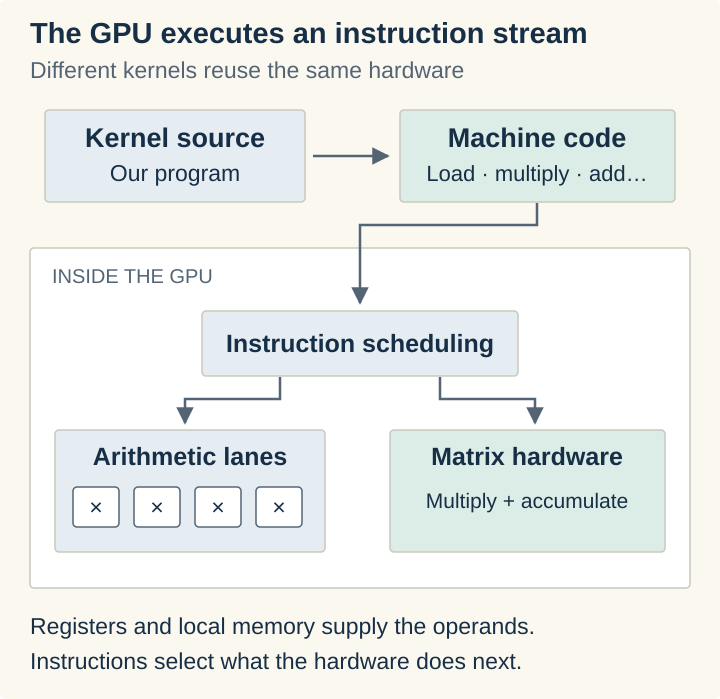

There are specialized pieces inside that machine too. Tensor cores perform small matrix multiply-and-accumulate operations in hardware. A kernel can use those instructions while arranging the loads, tiles, synchronization, and stores around them. When we call a library routine such as GEMM for matrix-matrix multiplication or GEMV for matrix-vector multiplication, we are asking software to select and run an implementation of that calculation. [cuBLAS](https://docs.nvidia.com/cuda/cublas/index.html) provides those routines on NVIDIA GPUs.

So even when much of the math goes through a specialized matrix unit, we are still running a program on the GPU. The program determines which operations happen, which data they consume, and where the results go. Our model's attention and feed-forward layers become work scheduled on that machinery.

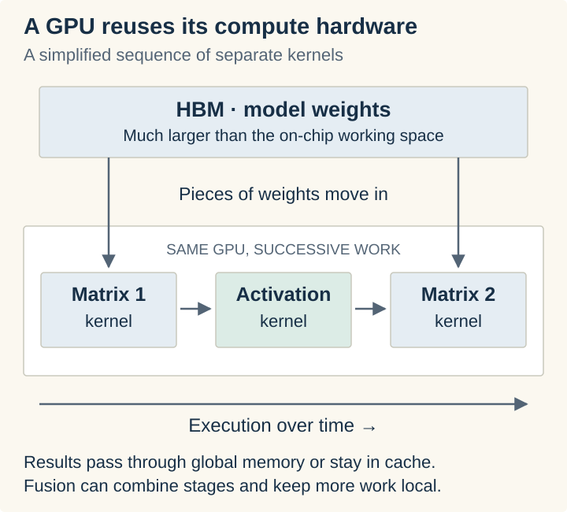

The memory side matters because a large model contains far more weights than we can keep beside those execution units. For a dense model with eight billion weights, storing each weight in two bytes takes about 16 GB. They generally live in high-bandwidth memory, HBM, beside the processor, and move through its smaller local memories as we calculate. Generating the next token uses most of those weights again.

GPU kernels work hard to reuse what they load and keep intermediate results close. Tiling divides a calculation into manageable pieces. Fusion combines operations to avoid unnecessary trips through memory. [FlashAttention](https://arxiv.org/abs/2205.14135) applies that reasoning to attention. But we are still describing how software uses a machine whose execution hardware is already laid out.

That is the starting point for understanding what changes with an FPGA.

## Conceptually, we build our own chip

An FPGA gives us a field of configurable logic, storage, and connections. Conceptually, we use those pieces to build our own chip: an arrangement of components that performs the calculation we want.

Start with a **lookup table**, or LUT. Think of it as a tiny truth table held in hardware. Two input bits can form four combinations: `00`, `01`, `10`, and `11`. We store an output bit for each combination. The input bits select the corresponding output.

If the stored outputs are `0, 0, 0, 1`, the LUT behaves as an AND gate. Only `11` produces a one. Change the stored outputs to `0, 1, 1, 0`, and the same LUT behaves as XOR: the output is one when the inputs differ.

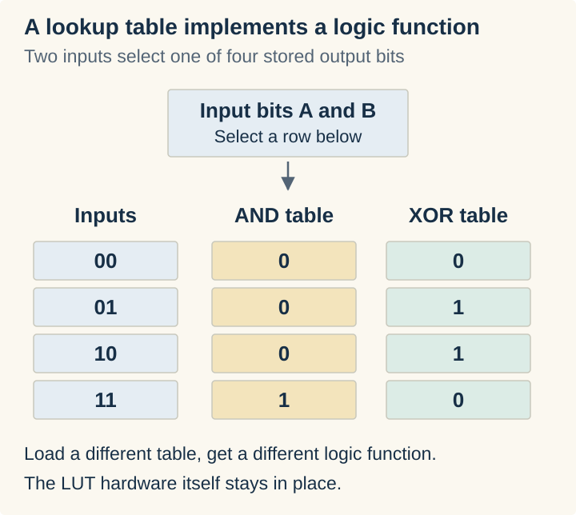

The configuration changes which function that piece of hardware performs. The transistors are already manufactured; the stored configuration controls the logic functions and selects paths through the available wiring. Real devices have larger LUTs, such as the six-input tables in [AMD's configurable logic blocks](https://docs.amd.com/r/en-US/ug574-ultrascale-clb/Look-Up-Table), but the idea is the same.

Now we can compose something useful. For two one-bit numbers, XOR gives us the sum bit and AND gives us the carry bit. Add an incoming carry to that logic and we have a full adder. Connect several of those stages, passing the carry along, and we can add wider numbers.

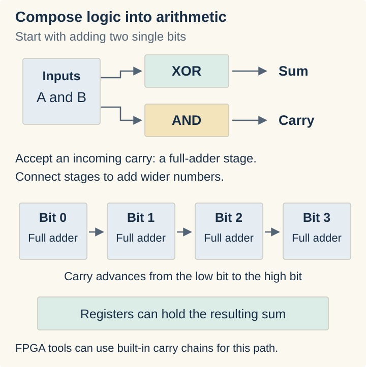

Keep composing those functions and we can build multipliers, comparisons, counters, and control logic. Flip-flops hold state between clock cycles. Memory blocks hold larger collections of values. Programmable routing connects outputs to inputs. Modern FPGAs also give us ready-made DSP blocks for arithmetic and fast carry chains, so the tools can use those instead of constructing every function from LUTs. We still decide what circuit those resources form.

We describe that circuit with a hardware description language, an HDL such as Verilog or VHDL. A description of two operations doesn't necessarily mean “execute this instruction, then that instruction.” It can mean “these two components exist, and this wire connects them.” Registers and clocked behavior establish where values are held as the circuit runs.

The toolchain then has a substantial job. Synthesis turns the description into logic and storage. Placement assigns that logic to actual sites on the FPGA. Routing finds connections between them, and timing analysis checks whether signals can arrive before the next clock edge. The result is a configuration bitstream we load into the device.

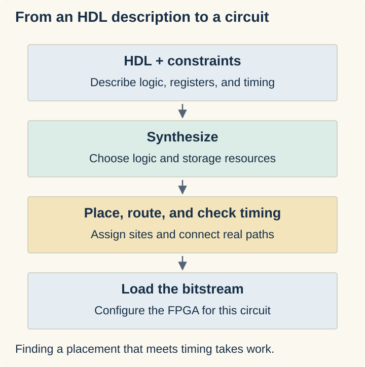

This is why an FPGA build can take so long. The tools are solving a physical arrangement problem with limited logic, routing, and timing budgets. Large designs can take hours, and a timing failure can send us back through the process. [Vivado's implementation flow](https://docs.amd.com/r/2024.1-English/ug904-vivado-implementation/Implementation-Sub-Processes) makes those separate jobs visible.

What we get for that effort is a circuit built for our work. If we need a multiply, then an add, then a clamp, we can give each operation its own stage and connect them. Once one input reaches the adder, the multiplier can work on the next input.

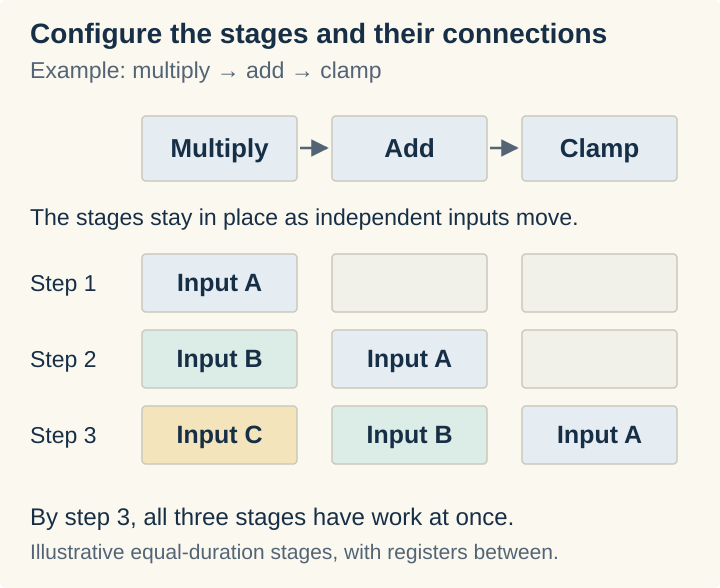

The GPU version follows instructions through its execution hardware. Here, we have arranged a path through hardware for the data to follow. That is the mental shift I needed before the RDU made sense.

## Give us larger components to arrange

Go back to our LUT. Loading one truth table made it an AND gate; loading another made it XOR. We used those functions to construct arithmetic. But a neural network needs an enormous amount of familiar arithmetic. What if we manufacture that machinery up front, then give ourselves configuration choices at that level?

Conceptually, take an arithmetic block with addition and multiplication already built into it. Configuration selects which operation to use, which inputs feed it, and where the result goes. Set it to add and feed it `2` and `3`: we get `5`. Select multiplication with the same inputs: we get `6`. We changed the function of the block without describing the gates that implement either operation.

The configuration still consists of stored bits controlling hardware. With the LUT, those bits supplied the answers to a small truth table. Here, they select operations and paths through larger, ready-made components. We have moved up a level in what we can arrange.

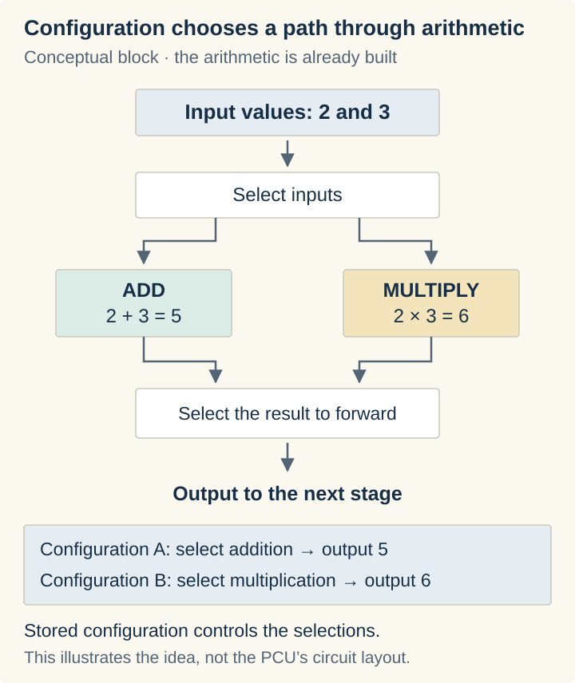

Now give one stage the job of multiplying an input by a scale factor. Connect its output to a stage configured to add a bias. Keep feeding values into that path and we have our multiply-then-add pipeline again. The arithmetic is already manufactured; our configuration gives it a job and connects it to the next piece of work.

That is the idea behind a **coarse-grained reconfigurable array**. The grain is the size of the pieces we arrange. Stanford's [Plasticine work](https://csl.stanford.edu/~christos/publications/2017.plasticine.isca.pdf) develops this approach, and SambaNova's RDU belongs to this family.

In the RDU, the compute block is a **Pattern Compute Unit**, or PCU. It contains a collection of arithmetic resources, so we can take the same idea further. In vector mode, lanes operate on many values in parallel, with stages connected into a pipeline. In matrix mode, the compute body becomes a systolic array: a grid of multiply-and-accumulate cells through which values advance, contributing to the matrix result as they move.

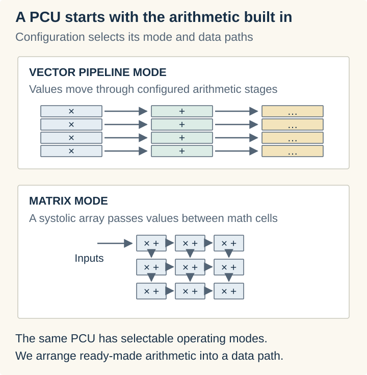

“Different modes” now has a physical meaning. We are choosing how the arithmetic resources work together and how values travel through them. The [SN40L's PCU design](https://arxiv.org/html/2405.07518v2#S4.SS1) has an input section feeding that compute body and an output section that can perform further operations on its results. Our simple add-or-multiply block is the mental model; the PCU gives us a much larger piece to configure.

Memory needs the same treatment. Having RAM beside the compute is useful, but we also need it to deliver values in the order the calculation expects. The RDU's **Pattern Memory Unit**, or PMU, combines local SRAM with configurable address generation and data handling.

Imagine a small matrix stored as two rows: `a, b, c` and `d, e, f`. Reading across the rows gives us `a, b, c, d, e, f`. Reading down the columns gives us `a, d, b, e, c, f`. The values haven't changed. The sequence of addresses has. The memory unit can generate those accesses as part of its configured work, feeding the compute stage the stream it needs.

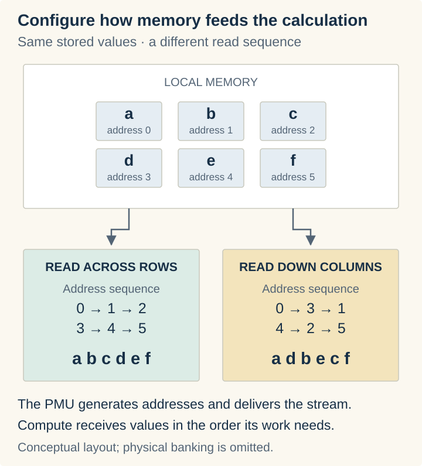

Then we configure the connections. A compute stage's output needs a destination, and a memory stage needs to know which consumer it is feeding. The **reconfigurable dataflow network** provides paths through switches between these units. The compiler assigns routes so the output of our multiplication reaches the buffer or arithmetic stage that needs it next.

We have carried the FPGA idea all the way through: choose what each component does, choose how it handles its inputs, and connect its output to another component. We can now build the calculation from compute, memory, and routes without first building its arithmetic from logic gates.

## Connect the pieces into an RDU

Put those compute and memory units across the chip, with switches between them. Add interfaces that bring data in from external memory and send results out. The compiler now has a set of resources it can assign: these units perform the matrix operation, these memories hold its inputs and outputs, and these paths connect it to the next operation.

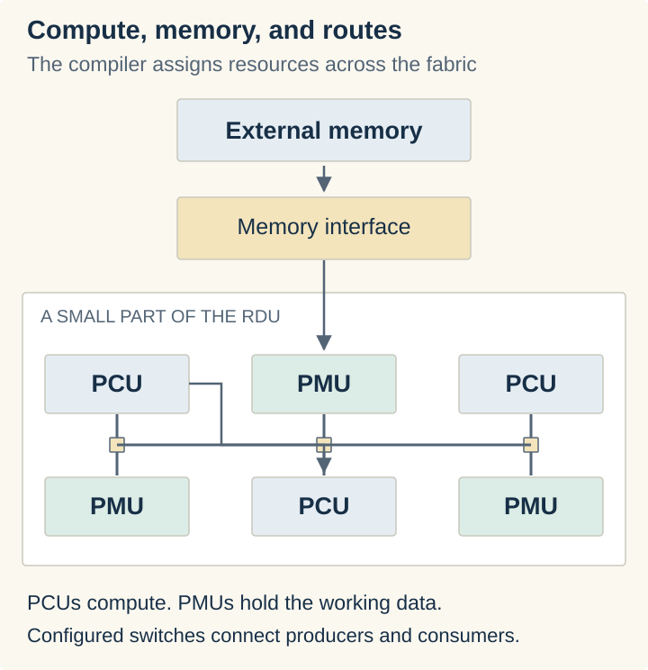

The important part is the relationship between the units. Suppose one PCU group multiplies a tile of values and puts its result in a PMU. Another PCU group consumes that tile and applies an activation function. A second buffer feeds the next matrix operation. The compute resources and their connections are assigned before that section runs.

Data availability drives progress. A stage runs when its inputs are ready and there is space for its output. If the next buffer fills, the producer waits. If the next stage is consistently slower, a bigger buffer only postpones the wait. The compiler has to balance the compute assigned to each stage with the memory and routes feeding it.

This also explains why “the PCU can add or multiply” is only part of the distinction. A GPU arithmetic unit can do that too. What we configure on the RDU is a connected arrangement of operations, buffers, and routes that remains in place while data flows through it. The arrangement expresses part of the program.

## Map the inference harness onto that machine

Now we can return to the software I started with.

An inference harness loads weights, prepares inputs, runs the model's operations, manages attention state, and selects the next token. On a GPU, the computational part becomes a sequence of kernel launches, possibly with operations fused together. For an RDU, the compiler takes that graph of operations and constructs mappings onto the available hardware.

Take a simple feed-forward network: multiply the input by a weight matrix, apply an activation function, then multiply by another weight matrix. An activation function applies a nonlinear transformation to the intermediate values. In software we might express it this way:

```text
hidden = matmul(input, weights_up)
hidden = activation(hidden)
output = matmul(hidden, weights_down)
```

We can follow each line into the hardware. A PMU holds an input tile. A group of PCUs in matrix mode multiplies it by tiles of `weights_up`. The result enters an on-chip buffer, then flows through the configured activation stage. Another group of PCUs performs the second multiplication using `weights_down`. The compiler allocates the buffers and connects those stages.

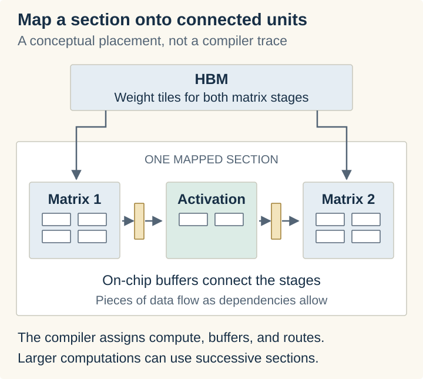

The dependencies in our three lines of software have become paths between resources. Within that mapping, we don't return to the host to launch each line separately. Tiles move through the connected stages as their inputs become available. This is where the FPGA detour pays off: I can picture the calculation as a circuit assembled from larger components.

Attention can be broken down the same way. Matrix operations form queries, keys, and values. Other operations calculate attention scores, normalize them with softmax, and combine the values. Compute units perform those operations; memory units hold the working tiles; routes carry the intermediate results. The KV cache still stores attention state from earlier tokens, and the mapping has to bring the required pieces of that state into the calculation.

A whole transformer is larger than our three-operation example. The compiler can split it into sections, reuse hardware across layers, and arrange work across multiple RDUs. SambaNova's [compiler overview](https://sambanova.ai/blog/accelerating-scientific-applications-with-sambanova-reconfigurable-dataflow-architecture) describes that progression from a model graph to placed and routed hardware configurations. We are laying out as much connected work as a mapping can hold, then sequencing the mappings needed to run the model.


The surrounding software still has a job. Requests need to be admitted and scheduled, text needs to be tokenized, and generation needs stopping rules. Sampling can live on the host or device depending on the implementation. The RDU gives us a different execution target for the model's computation; it doesn't remove the need for an inference system around it.

And the next generated token still depends on the previous one. The pipeline overlaps work that is ready, such as successive tiles or independent requests. What changes is how we arrange and feed that work, which brings us back to memory.

## The weights still have to live somewhere

Laying out the computation does not mean laying every weight permanently beside its own multiplier. This was an important distinction for me, because it is easy to hear “the model is on the chip” and picture exactly that.

The [SN40L paper](https://arxiv.org/html/2405.07518v2) describes three memory tiers per socket: 520 MiB of on-chip SRAM, 64 GiB of HBM, and up to 1.5 TiB of attached DDR memory. SRAM provides fast local storage for the mapped work. HBM feeds the active computation. DDR provides much more capacity, including space for models that aren't currently running.


Our roughly 16 GB model plainly doesn't fit in that SRAM. Its weights still have to stream into the compute units. The spatial mapping helps keep intermediate work local and sustain the flow through connected operations. In the paper's decoder example, SambaNova reports fusing an entire decoder layer into one kernel call.

The larger DDR tier addresses another problem: keeping many models available without giving every inactive model its own share of expensive HBM. Bringing a model into HBM still takes time, but the architecture provides a nearby capacity tier for that purpose.

So there are two useful ideas here. One concerns how we execute a calculation. The other concerns how we hold and switch between the models we want to serve. They meet at the memory system, but they solve different parts of the serving problem.

## Bring that into our own datacenter

This is where the hardware starts to matter to someone deciding whether they can afford to run these models themselves.

The cost is the whole installation. We need machines to hold the models and serve the traffic, then power, cooling, and space to keep those machines running. Reducing that footprint buys us a choice: spend less to serve the same workload, or put more inference capacity into the same budget.

The memory arrangement we just walked through is part of that. Keeping inactive models in DDR means we don't have to provision expensive accelerator memory just to have them available. Keeping intermediate calculations close to the compute reduces the traffic we need to sustain. Those choices are aimed at getting useful work out of a smaller installation.

There is a concrete deployment behind that idea. SambaNova's [2025 SambaStack datasheet](https://sambanova.ai/hubfs/SambaStack%20data%20sheet%2006%2025%2025%20v2.pdf) describes an SN40L-based, air-cooled system drawing an average of 10 kW. That is still serious equipment, but it puts the conversation in terms of an installation an organization can accommodate in an existing datacenter, without first building a liquid-cooling plant for it.

We can also keep the entire inference service inside the organization. SambaNova explicitly offers [on-premises and air-gapped SambaStack deployments](https://github.com/sambanova/sambastack-tools#getting-started). In an air-gapped installation, the models run on our hardware, requests stay within the isolated environment, and inference doesn't depend on reaching an outside model API.

GPUs can be deployed that way too. The opportunity here is to make the capacity we need affordable and practical to host locally. For an organization working with data that cannot leave its environment, that combination matters: enough model capacity, a manageable power and cooling requirement, and control over where the work happens.

I started with a question about what this chip was doing differently. Following it through FPGAs gave me a way to picture the answer: configure the components, connect the computation, and move data through it. Follow that arrangement out to the machines we have to buy and operate, and it becomes a question about who can afford to run their own models. That is what makes this worth understanding.
